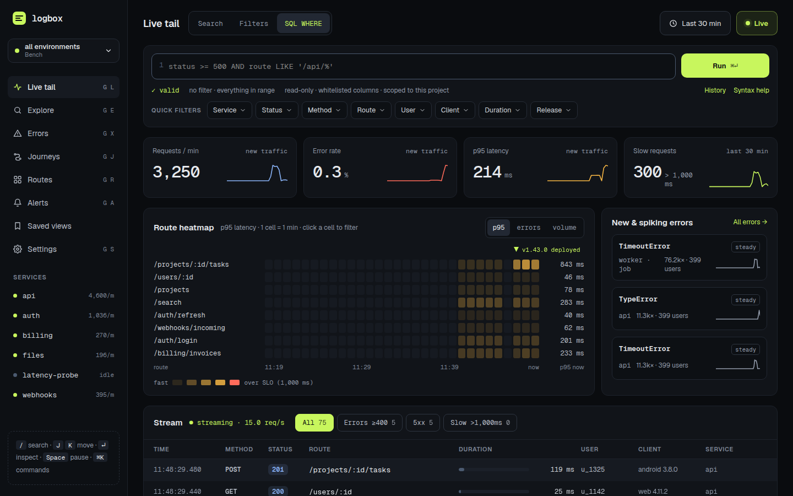
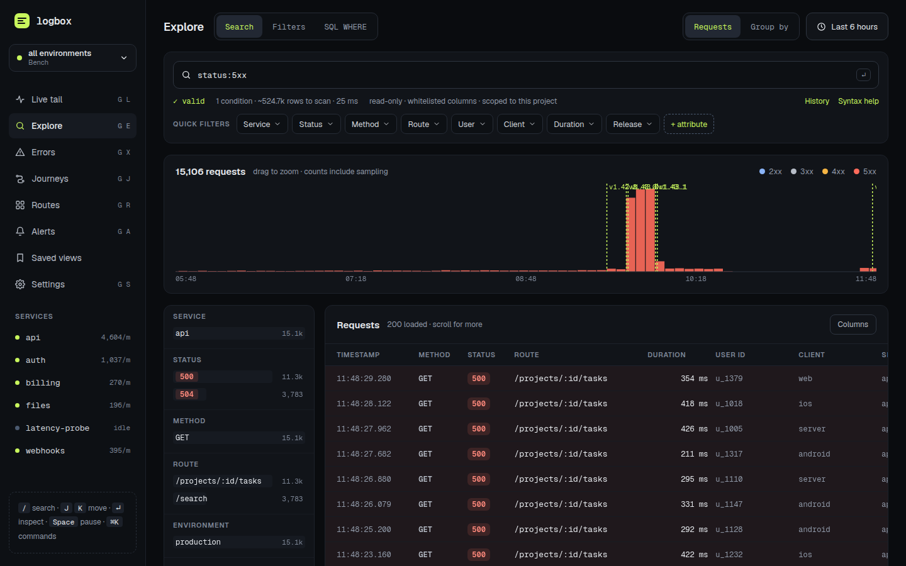
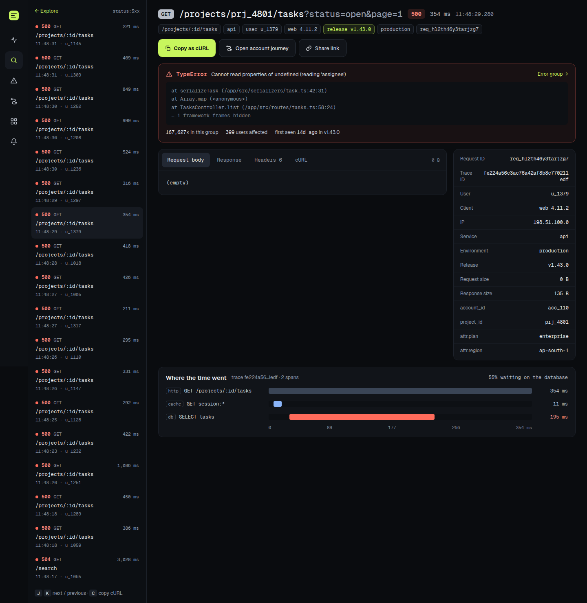
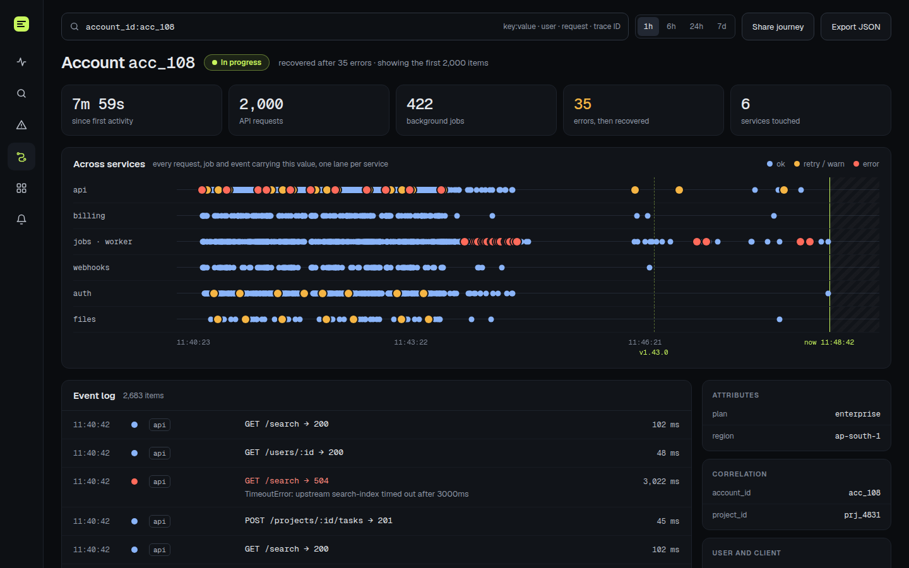
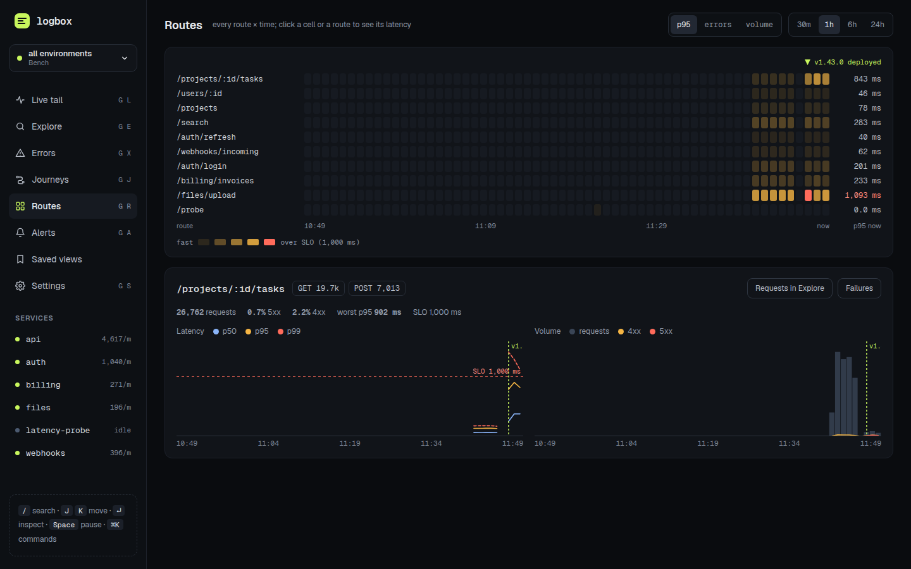
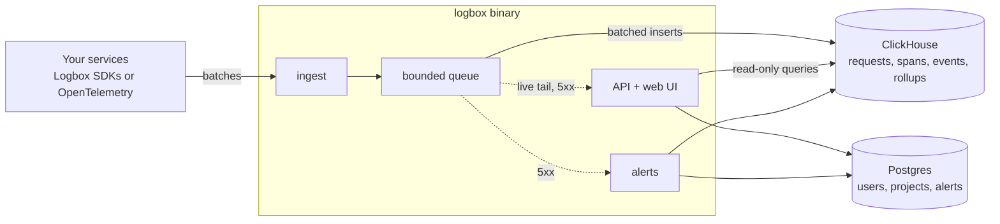

# Logbox

**Self-hosted API request logging: see every request your services handle, query them with SQL, and follow one customer's journey across services and background jobs.**



Logbox records each HTTP request (route, timing, status, user, journey keys, and bodies when something goes wrong), plus spans, background jobs and log lines. Tiny SDKs send it in the background without slowing your app down; one Rust binary stores it in ClickHouse and serves a fast, keyboard-first UI. It runs on a single small server and is Apache-2.0 licensed.

## Features

- **Live tail** of requests as they happen, with tiles, a route heatmap with release markers, and new or spiking errors.
- **Explore with a SQL `WHERE` filter** (`status >= 500 AND route LIKE '/checkout/%'`), a quick search syntax (`status:5xx user:u_42`) or filter chips, all shareable by URL. Group by any column with p50/p95/p99.
- **Request inspector:** headers, bodies, the error and its stack, a timing waterfall, nearby requests, copy as cURL and replay to an allowed target.
- **Journeys:** everything that happened for one account, order, session or user, across services and background jobs, on one timeline.
- **Errors** grouped by fingerprint, with first and last seen, users affected, the release that introduced them and trends.
- **Routes:** a heatmap of latency, errors or volume per route and minute, and per-route charts.
- **Alerts:** rules on 5xx rate, p95 latency, counts or new and spiking errors, sent to email, Slack, Telegram or signed webhooks; plus a real-time **Email on 5xx** with throttling, digests and one-click mute links.
- **SDKs** for Express, Fastify, NestJS (with a Logger bridge and BullMQ), Django, FastAPI/Starlette and Celery, and an **OpenTelemetry (OTLP/HTTP) receiver** for everything else.
- **Secure by default:** redaction in the SDK and again on the server, IP masking, roles and a separate "can view bodies" permission, read-only query execution, optional OIDC single sign-on.
- **Fast:** 50,000 events/s ingest on 4 vCPU; filtered queries over 100 million requests in well under half a second ([benchmarks](docs/benchmarks.md)).

## Quickstart (about a minute)

```bash
git clone https://github.com/karaa1122/LogBox && cd LogBox/deploy
docker compose up -d        # builds the image the first time; set LOGBOX_IMAGE to use a published one
```

Open http://localhost:8080. The setup wizard creates your account and first project and shows its ingest key. Want data right away? Run the demo traffic generator, which includes a scripted incident:

```bash
docker compose exec logbox logbox demo --url http://localhost:8080
```

For production, copy `deploy/.env.example` to `deploy/.env` and read [self-hosting.md](docs/self-hosting.md) (sizing, TLS, backups).

## Send requests from your app

**Express**

```ts
import express from 'express';
import { init, logbox, logboxErrorHandler } from '@logbox/express';

init({ service: 'orders-api' }); // LOGBOX_ENDPOINT and LOGBOX_INGEST_KEY from the environment
const app = express();
app.use(logbox());
// ... your routes
app.use(logboxErrorHandler());
```

**NestJS**

```ts
@Module({ imports: [LogboxModule.forRoot({ service: 'orders-api' })] })
export class AppModule {}
```

**FastAPI / Starlette**

```python
import logbox
from logbox.asgi import LogboxMiddleware

logbox.init(service="orders-api")
app = FastAPI()
app.add_middleware(LogboxMiddleware)
```

**Django**

```python
MIDDLEWARE = ["logbox.django.LogboxMiddleware", ...]
LOGBOX = {"service": "orders-api"}
```

**OpenTelemetry**

```bash
OTEL_EXPORTER_OTLP_ENDPOINT=http://localhost:8080/v1/otlp
OTEL_EXPORTER_OTLP_HEADERS=Authorization=Bearer%20lbx_ingest_…
```

Attach the user and journey keys anywhere in a request (`setUser(id)`, `setCorrelation('order_id', id)`), and background jobs and log lines started from it are linked automatically. Fastify, Celery, BullMQ, logging bridges and all options: [SDK docs](docs/sdk-spec.md) and [examples/](examples).

## A closer look

| | |
|---|---|
|  |  |
| **Explore:** filter, chart and page through requests | **Inspector:** one request with its error, spans and context |
|  |  |
| **Journeys:** one account across services and jobs | **Routes:** latency and errors per route and minute |

## How it works



One process (`logbox all`) handles everything for most installs; ingest, API and alerts can also run separately with Redis for live tail. Details in [architecture.md](docs/architecture.md).

## Documentation

- [Architecture](docs/architecture.md) and [decisions](docs/DECISIONS.md)
- [Self-hosting](docs/self-hosting.md), [configuration](docs/configuration.md) and [security](docs/security.md)
- [Query language](docs/query-language.md)
- [Alerts and email](docs/alerts.md)
- [Ingest protocol and OpenTelemetry](docs/ingest-protocol.md), [HTTP API](docs/api.md)
- SDKs: [behaviour](docs/sdk-spec.md), [Node core](docs/sdk-node.md), [Express](docs/sdk-express.md), [Fastify](docs/sdk-fastify.md), [NestJS](docs/sdk-nestjs.md), [Python](docs/sdk-python.md)
- [Benchmarks](docs/benchmarks.md)

## Contributing

Issues and pull requests are welcome; see [CONTRIBUTING.md](CONTRIBUTING.md) for the one-command dev setup. Please report security issues privately ([SECURITY.md](SECURITY.md)).

## License

[Apache-2.0](LICENSE)
