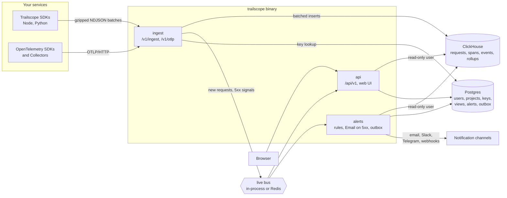

# Architecture

Trailscope is one Rust binary, a ClickHouse database for telemetry and a Postgres database for everything else. The web UI is compiled into the binary.

## Roles

`trailscope <role>` runs one part, or all of them:

| Command | What runs |
|---|---|
| `trailscope all` | ingest, API, UI and alerts in one process; the live bus is an in-process broadcast channel. The default, and enough for most installs |
| `trailscope ingest`, `trailscope api`, `trailscope alerts` | one role each, for scaling ingest and the API separately ("split mode"); the live bus is Redis pub/sub. Run exactly one `alerts` process |
| `trailscope migrate` | applies ClickHouse and Postgres migrations, creates the read-only ClickHouse user and syncs retention TTLs, then exits. `all` does this at startup |
| `trailscope demo` | generic SaaS demo traffic with a scripted incident, or a load test (`--load`) |
| `trailscope healthcheck` | used by the container health check |

## Ingest path

1. An SDK batches items in memory (bounded queue, never blocking the request) and sends gzipped NDJSON to `POST /v1/ingest` with an ingest key. OpenTelemetry exporters send OTLP/HTTP to `/v1/otlp/v1/{traces,logs}`, which is mapped onto the same item types ([ingest-protocol.md](ingest-protocol.md)).
2. The key is looked up (cached) and the batch is decompressed with a size cap, split into items and processed on a bounded number of workers: validation, route templating, truncation, server-side redaction with the project's rules, and error fingerprinting.
3. Rows go into a queue bounded by row count and bytes. When it is full, ingest answers `429` with `Retry-After` (SDKs back off), so memory stays bounded under overload.
4. A writer flushes the queue to ClickHouse every second (or sooner at 20,000 rows) with up to four inserts in flight, retrying on failure. After each flush it publishes the new requests to the live bus for Live tail, and the 5xx requests, without bodies, headers or IPs, for Email on 5xx.

On shutdown the server stops accepting connections first, then drains the queue.

## Storage

**ClickHouse** (telemetry; raw tables are `MergeTree` partitioned by day, rollups are aggregating tables partitioned by month, all with TTL-based retention):

| Table | Contents |
|---|---|
| `requests` | one row per HTTP request: timing, route, status, user, correlation keys, attributes, headers and bodies (bodies and headers have a shorter TTL) |
| `spans` | timed operations inside a request (database, cache, external calls), keyed by trace ID |
| `events` | job runs, log lines and custom events |
| `route_minute` | per route and minute: counts by status class and latency quantile states (a materialized view over `requests`) |
| `error_groups`, `error_minute` | per error fingerprint: first/last seen, counts, users, sample request; per-minute counts (materialized views over `requests` and `events`) |

Charts and tiles (overview, route heatmap, error trends) read the rollups. Explore, the inspector and journeys read the raw tables.

**Postgres** (metadata, migrated with sqlx): users, sessions, invites, projects, environments, ingest keys and API tokens (SHA-256 hashes only), redaction rules, releases, saved views, replay targets and the replay log, settings, alert rules and channels, the built-in Email on 5xx rule, per-error-group email state, and the notification outbox (which is also the send history).

## Queries

The query language ([query-language.md](query-language.md)) is parsed with `sqlparser` into Trailscope's own AST, checked against a registry of allowed columns, and compiled to a parameterized `WHERE` clause: user values are always bound parameters, never SQL text. The same AST is evaluated in memory for Live tail and Email on 5xx filters, so a filter means the same thing everywhere. Every user-driven query runs as a read-only ClickHouse user whose settings profile caps execution time, rows read, result size and memory.

## Live tail

Ingest publishes each flushed request (a summary without bodies) to the live bus. Each Live tail connection is a Server-Sent Events stream that evaluates its filter in memory and is rate-limited per client; slow clients get `skipped` markers instead of growing buffers. In split mode the bus is Redis pub/sub, so any API process can serve any stream.

## Alerts

The alerts role evaluates rules every minute as the read-only user, keeps each rule's state (ok or firing) in Postgres, and queues one notification per state change. The built-in Email on 5xx rule runs in real time on the 5xx signals from the live bus, with per-error-group throttling, digests, an hourly cap, regressions and signed mute links. A worker delivers queued notifications (email over SMTP, Slack, Telegram, signed webhooks) with retries. See [alerts.md](alerts.md).

## Web UI

A React single-page app (TanStack Router, Query and Virtual, CodeMirror for SQL mode, hand-written SVG charts) built with Vite and embedded with `rust-embed`. It talks only to `/api/v1`, with a session cookie and a CSRF token. Long tables are virtualized; the initial JavaScript is about 200 KB gzipped.

## Crates

| Crate | Role |
|---|---|
| `trailscope-core` | configuration, wire and row types, ClickHouse and Postgres clients and migrations, the live bus, secrets helpers |
| `trailscope-query` | the query language: parser, column registry, compiler, evaluator, search syntax, filter chips |
| `trailscope-ingest` | ingest endpoints (including OTLP), validation, redaction, fingerprinting, the write pipeline |
| `trailscope-api` | the HTTP API: auth, members, projects, queries, inspector, replay, live tail, journeys, errors, routes, views, alerts, single sign-on, OpenAPI |
| `trailscope-alerts` | rule evaluation, Email on 5xx, channels, encryption of stored secrets, the outbox |
| `trailscope-demo` | demo data and load testing |
| `trailscope-server` | the `trailscope` binary: CLI, wiring, health and metrics endpoints, embedded UI |

Judgement calls behind all of this are recorded in [DECISIONS.md](DECISIONS.md).
